<!-- Layout note: everything stays in ONE html block (no blank lines) so GitHub adds no paragraph margins; blocks are separated only by assets/spacer.svg, which keeps every gap identical. -->


&nbsp;
&nbsp;

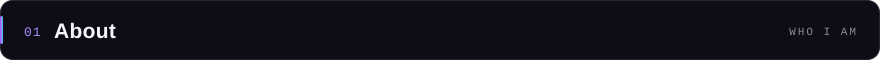

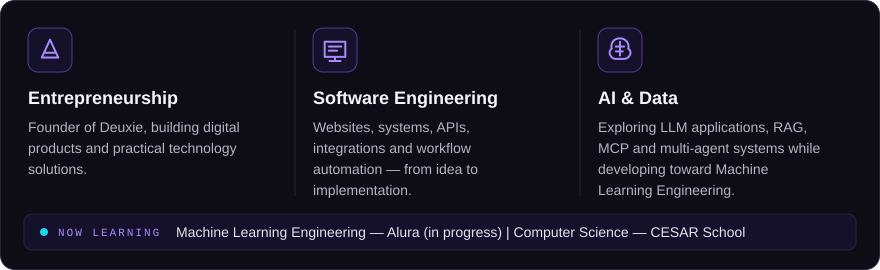

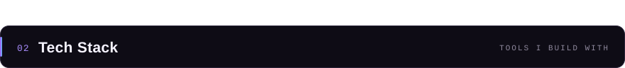

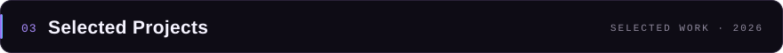

<a href="https://github.com/ester-acm/agentes">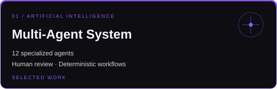</a><a href="https://deuxie.com.br">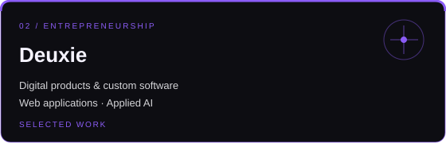</a>

<a href="https://sampaiogrossi.com.br">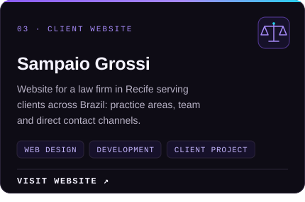</a>

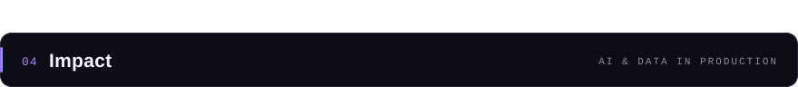

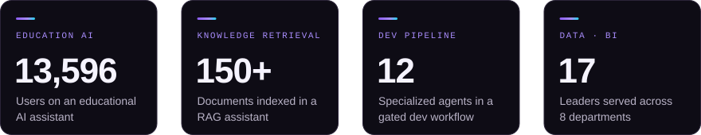

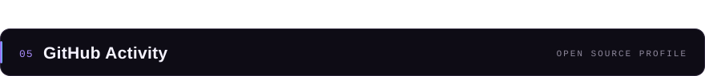

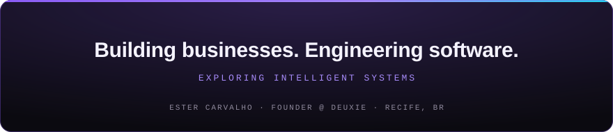

&nbsp;
&nbsp;

